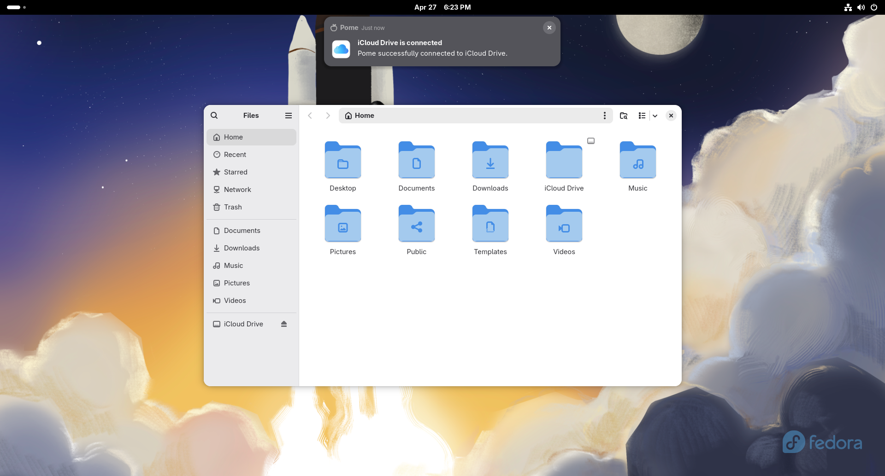

<h1> Pome</h1>

Pome gives Linux desktops a quiet iCloud Drive folder.



Pome keeps iCloud Drive available at `~/iCloud Drive` and reconnects when you log in. On first launch, a desktop notification asks you to sign in through the browser. If the connection needs attention later, notifications let you retry or sign in again.

The Flatpak includes rclone, so there is no separate rclone installation or first-launch download.

## Building Locally

Local builds use Flatpak Builder. You will need:

- Node.js and npm (the Flatpak bundles Node.js 24)
- `flatpak` and `flatpak-builder`
- host FUSE mount support (`fusermount3` or `fusermount`)
- a working desktop notification portal
- the Freedesktop runtime and SDK used by the manifest

Add Flathub if you do not already have it:

```sh
flatpak remote-add --if-not-exists flathub https://flathub.org/repo/flathub.flatpakrepo
```

Install the runtime and SDK:

```sh
flatpak install flathub org.freedesktop.Platform//25.08 org.freedesktop.Sdk//25.08
```

Build and install Pome locally:

```sh
npm run flatpak-install
```

Run the local build:

```sh
flatpak run io.github.gabrielpalassi.Pome
```

## Development

Create a branch from the latest `master`, keep changes focused, and open a pull request when ready. Follow the existing TypeScript style and prefer portals for desktop integration.

Install dependencies and run the checks and tests:

```sh
npm ci
npm run check
npm test
```

`npm run check` runs TypeScript, ESLint, and Prettier checks without changing files. `npm test` builds the app and runs the tests. Use `npm run check:fix` to apply lint and formatting fixes, or `npm run build` to build without running tests.

Changes to packaging, autostart, notifications, sign-in, or host commands also need testing in the installed Flatpak. Build and launch it using the commands above, then exercise the affected desktop flow.

### Host integration

Pome keeps most host interaction in `src/lib/host.ts`, `src/lib/rclone.ts`, and portal-specific helpers. Keep host-side commands limited to work that needs to happen outside the sandbox.

The Flatpak stages its bundled rclone in `~/.var/app/io.github.gabrielpalassi.Pome/data/libexec/`, using a content hash in the filename. Pome verifies and reuses that copy on subsequent launches, and stages a new copy when the bundled binary changes. It runs outside the sandbox to keep `~/iCloud Drive` available to other applications, while continuing to use the host's existing rclone configuration. Native development runs still require rclone on `PATH`.

The rclone version, archive checksum, and license source are pinned in both Flatpak manifests. Update them together when upgrading rclone. Like the existing Node and Chrome bundles, this archive targets x86-64 Linux.

### Flatpak packaging

`npm run flatpak-install` uses `io.github.gabrielpalassi.Pome.local.yml` to build from the working tree. The release manifest, `io.github.gabrielpalassi.Pome.yml`, builds from a published Git tag.

If npm dependencies change, use `flatpak-node-generator` to update the offline sources and verify the Flatpak build:

```sh
npm install --package-lock-only --lockfile-version=2
flatpak-node-generator npm package-lock.json -o generated-sources.json
npm run flatpak-install
```

Keep `package-lock.json` at lockfile version 2 so `flatpak-node-generator` can generate complete offline npm sources.

### Releases

When preparing a release:

1. Finish the release changes on a branch.
2. Bump the app version in `package.json` and `data/io.github.gabrielpalassi.Pome.metainfo.xml`.
3. Run:

```sh
npm install --package-lock-only --lockfile-version=2
```

4. Merge the pull request into `master`.
5. Pull the updated `master` branch locally.

```sh
git checkout master
git pull origin master
```

6. Create and push the release tag from `master`.

```sh
git tag -a v1.0.0 -m "Release v1.0.0"
git push origin v1.0.0
```

7. Open a follow-up pull request that updates:

   - `io.github.gabrielpalassi.Pome.yml`: set `tag` and `commit` to the published release.
   - `data/io.github.gabrielpalassi.Pome.metainfo.xml`: update the screenshot `image` URL to the published tag.

```sh
git rev-parse HEAD
```
